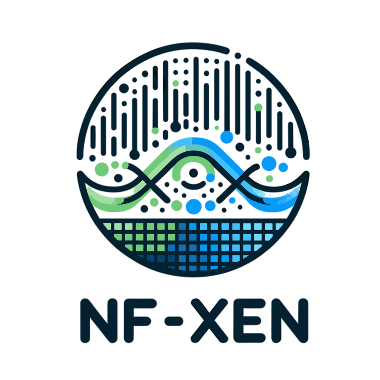
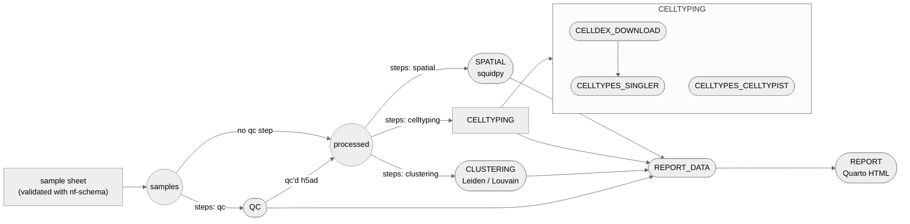

<p align="center">
    
</p>

# nf-xen

|  |  |  | [](https://doi.org/10.5281/zenodo.17305888) |

`nf-xen` is a [Nextflow](https://www.nextflow.io/) pipeline for downstream analysis of 10x Xenium spatial transcriptomics data, from an annotated `AnnData` (`.h5ad`) object to a rendered HTML report: quality control, clustering, cell type annotation, spatial statistics, and a Quarto report per run.

## Pipeline overview



Each sample declares its own `steps` (`qc`, `clustering`, `celltyping`, `spatial`) in the sample sheet — every module runs once and samples are routed to it by channel filtering. Downstream steps automatically use the QC'd object when QC ran for that sample, and the raw input otherwise.

## Features

- **Modern Nextflow**: DSL-2 modules with the strict parser (Nextflow ≥ 25.10), `nf-schema` plugin for parameter and sample-sheet validation, Wave/community containers, per-label resource model (`lowMemMT`, `highMemMT`, `highMemST`, `lowMemST`, `process_single`).
- **QC** informed by Xenium best practice (Salmelin *et al.* 2025, *Nature Methods*; 10x Xenium Onboard Analysis metrics): count/gene/area/area-ratio thresholds, negative-control and doublet handling, per-gene cell-count filter, QC PDF.
- **Clustering**: Leiden (default) or Louvain, multiple resolutions, UMAP/tSNE-free PDF summaries sized for Xenium panels.
- **Cell typing**: two interchangeable backends — SingleR + celldex references (auto-downloaded HDF5SummarizedExperiment tarballs or local files) and CellTypist models (auto-downloaded or local `.pkl`).
- **Spatial**: squidpy neighbourhood enrichment, co-occurrence and Moran's I spatially-variable genes.
- **Report**: one Quarto-rendered HTML report per run combining every step's summary JSON and figures.
- **Reproducibility**: containers for every process, offline profile, HPC profiles.

## Requirements

- [Nextflow](https://www.nextflow.io/) ≥ 25.10 (Java 17+)
- [Docker](https://www.docker.com/) / [Apptainer](https://apptainer.org/) / [Singularity](https://sylabs.io/) (recommended)

## Quick start

```bash
nextflow run addityea/nf-xen --sampleSheet samplesheet.csv -profile docker --outdir results
```

Or from a clone:

```bash
git clone https://github.com/addityea/nf-xen.git && cd nf-xen
nextflow run main.nf --sampleSheet tests/sample_sheet_full.csv -profile docker --outdir results -resume
```

A minimal sample sheet:

```csv
sample,input,steps
T1,/path/to/tissue1.h5ad,"qc,clustering,celltyping,spatial"
```

Run the bundled test dataset with `nextflow run main.nf -profile test,docker`.

### Test profiles (nf-core style)

| Profile | Data | Purpose |
| ------- | ---- | ------- |
| `test` | Bundled synthetic toy dataset (`tests/toy_xenium.h5ad`, ~400 cells × 79 genes, no download needed) | Smoke-test the whole flow — sample-sheet validation, QC, clustering, spatial, report — in a couple of minutes. Cell typing is skipped (it needs reference downloads). |
| `test_full` | Public 10x Xenium human pancreas FFPE dataset (111 MB, auto-downloaded from Hugging Face) | Real data, every step including SingleR (monaco_immune) and CellTypist — small but meaningful outputs. |

```bash
nextflow run main.nf -profile test,docker          # toy smoke test
nextflow run main.nf -profile test_full,docker     # real small dataset, all steps
```

The toy dataset is deterministic and can be regenerated with `python3 bin/make_toy_h5ad.py`.

## Sample sheet

The sample sheet is validated against `assets/samplesheet_schema.json` (nf-schema). Only `sample`, `input` and `steps` are required; everything else is optional and falls back to pipeline defaults.

| Column | Description |
| ------ | ----------- |
| `sample` | Unique sample id `[A-Za-z0-9_]`. **[required]** |
| `input` | Path to the Xenium `.h5ad` (AnnData) file. **[required]** |
| `steps` | Comma-separated subset of `qc,clustering,celltyping,spatial`. **[required]** |
| `region_col` | `obs` column with region labels; the region matching the sample name (or this value) is analysed. Empty = all cells. |
| `min_counts` / `max_counts` | Transcripts per cell bounds (`-1` disables). |
| `min_genes` / `max_genes` | Genes per cell bounds (`-1` disables). |
| `min_cell_area` / `max_cell_area` | Cell area bounds in µm² (`-1` disables). |
| `min_area_ratio` / `max_area_ratio` | Nucleus/cell area ratio bounds (`-1` disables). |
| `max_nucleus_area` | Nucleus area upper bound (`-1` disables). |
| `min_cells_per_gene` | Drop genes detected in fewer cells (`-1` disables). |
| `max_control_fraction` | Fail sample if negative-control probe fraction exceeds this (`-1` disables). |
| `exclude_doublets` | Drop cells flagged `is_doublet` (Xenium Onboard Analysis ≥ 2.0 / Xenium Analyzer outputs). |
| `clustering_resolutions` | Comma-separated resolutions, e.g. `0.4,0.6,0.8`. Empty = `--clustering_resolutions`. |
| `celldex_ref` | SingleR reference(s): `name__version` (e.g. `monaco_immune__2024-02-26`, auto-downloaded) or path to a local HDF5SummarizedExperiment `.tar.gz`. Join several with `--`. |
| `celldex_labels` | `colData` label column per reference, joined with `--` (e.g. `label.main--label.fine`). |
| `celltypist_model` | CellTypist model name(s) (e.g. `Immune_All_Low.pkl`) or local `.pkl` path(s), joined with `--`. Empty = `--celltypist_model`. |

Example with everything enabled:

```csv
sample,input,steps,region_col,min_counts,max_counts,min_genes,max_genes,min_cell_area,max_cell_area,min_area_ratio,max_area_ratio,max_nucleus_area,min_cells_per_gene,max_control_fraction,exclude_doublets,clustering_resolutions,celldex_ref,celldex_labels,celltypist_model
460_13,/data/460_13_xenium_adata_regions.h5ad,"qc,clustering,celltyping,spatial",all_regions,10,500,5,110,20,500,0.1,0.9,110,5,-1,false,0.6,monaco_immune__2024-02-26,label.main,
```

## Parameters

Global parameters (validated against `nextflow_schema.json`, see `nextflow run main.nf --help`):

| Parameter | Default | Description |
| --------- | ------- | ----------- |
| `--sampleSheet` | `null` | Sample sheet CSV. |
| `--outdir` | `results` | Output directory. |
| `--cpus` / `--memory` / `--time` | `14` / `20.GB` / `10h` | Default per-task resources. |
| `--retry` | `3` | Retry count for failed tasks. |
| `--clustering_method` | `leiden` | `leiden` or `louvain`. |
| `--clustering_resolutions` | `0.5,0.8,1.0,1.2` | Default resolutions when not set per sample. |
| `--n_neighbors` | `15` | kNN graph neighbours for clustering. |
| `--celltyping_method` | `singler` | `singler`, `celltypist` or `both`. |
| `--celltypist_model` | `Immune_All_Low.pkl` | Default CellTypist model. |
| `--celltypist_majority_voting` | `true` | CellTypist majority voting. |
| `--spatial_knn` | `6` | Spatial KNN graph for squidpy. |
| `--spatial_top_svg` | `20` | Top spatially variable genes (Moran's I). |
| `--container_python` | `saditya88/nf-xen:python-1.0` | scanpy/squidpy/celltypist image (build with `docker build -t saditya88/nf-xen:python-1.0 docker/`, or use your own). |
| `--container_singler` | `saditya88/singler:0.0.1` | R/SingleR/celldex image. |
| `--container_quarto` | `ghcr.io/quarto-dev/quarto:latest` | Quarto image for the report. |

## Profiles

| Profile | Purpose |
| ------- | ------- |
| `test` | Toy smoke test: bundled synthetic dataset, whole flow, no downloads. |
| `test_full` | Small public dataset (10x Xenium human pancreas, 111 MB) with every step enabled. |
| `docker` / `arm` | Docker (arm adds `--platform linux/amd64` for Apple Silicon). |
| `apptainer` | Apptainer/Singularity with Wave `oras://` images. |
| `offline` | Pre-pulled Apptainer images in `conts/` (see below). |
| `pdc_kth` | PDC Dardel (KTH) SLURM cluster. |
| `uppmax` | UPPMAX (miarka/pelle/snowy/rackham) SLURM cluster. |

### Offline setup

Pull all containers on a machine with network access, then move the repo:

```bash
cd conts && bash get_all.sh
```

Then on the offline machine:

```bash
nextflow run main.nf --sampleSheet sheet.csv -profile offline -resume
```

CellDex auto-download obviously fails offline: provide local `.tar.gz` reference paths in the `celldex_ref` column instead.

## Output

```
results/
├── <sample>/
│   ├── qc/          <sample>_qc.h5ad, <sample>_qc.pdf, <sample>_qc_summary.json
│   ├── clustering/  <sample>_<method>.h5ad, <sample>_clustering.pdf, ..._summary.json
│   ├── celltypes/   <sample>_predictions.csv | <sample>_celltypist_predictions.csv, PDFs, summaries
│   └── spatial/     <sample>_morans_i.csv, <sample>_spatial.pdf, ..._summary.json
└── nf-xen-report.html   # Quarto report: run info, parameters, per-sample results, figures
```

Nextflow's own run artifacts (`nextflow_report.html`, `timeline.html`, `dag.html`, `trace.txt`) are also written to `--outdir`.

The QC'd `.h5ad` keeps raw counts in `layers['counts']` and stores CPM(1e4)+log1p in `X`, ready for downstream tools.

## Gensheet: create sample sheets with ease

A small Streamlit app in `gensheet/` helps build sample sheets interactively.

```bash
cd gensheet
pixi install && pixi run streamlit run app.py
```

Or with Docker (mount your data at the same absolute path so the app can emit real paths):

```bash
docker run --rm -v '/path/to/h5ad_files/':'/path/to/h5ad_files' -p 8501:8501 saditya88/nf-xen:gensheet
```

## Programs used

| Program | Purpose | Link |
| ------- | ------- | ---- |
| `Nextflow` | Workflow management | [nextflow.io](https://www.nextflow.io/) |
| `nf-schema` | Parameter & sample-sheet validation | [nf-schema](https://github.com/nextflow-io/nf-schema) |
| `Scanpy` | Single-cell analysis | [scanpy](https://scanpy.readthedocs.io/) |
| `Squidpy` | Spatial transcriptomics analysis | [squidpy](https://squidpy.readthedocs.io/) |
| `Anndata` | Annotated matrix container | [anndata](https://anndata.readthedocs.io/) |
| `SingleR` + `celldex` | Reference-based cell type annotation | [SingleR](https://bioconductor.org/packages/release/bioc/html/SingleR.html), [celldex](https://bioconductor.org/packages/release/data/experiment/html/celldex.html) |
| `CellTypist` | Model-based cell type annotation | [celltypist.org](https://www.celltypist.org/) |
| `AnndataR` | AnnData ⇄ SingleCellExperiment bridge | [anndataR](https://github.com/scverse/anndataR) |
| `Quarto` | HTML report rendering | [quarto.org](https://quarto.org/) |

## Contributing

Contributions are welcome — please fork and open a pull request.

## Acknowledgments

QC thresholds and filtering strategy follow Xenium best practice from Salmelin *et al.* 2025 (*Nature Methods*), "Optimizing Xenium In Situ data utility by quality assessment and best-practice analysis workflows", and 10x Xenium Onboard Analysis metrics. HPC profiles originally written by Pontus Freyhult (@pontus) and adapted by Aditya Singh (@addityea).

For questions or issues, open an issue in the repository.
